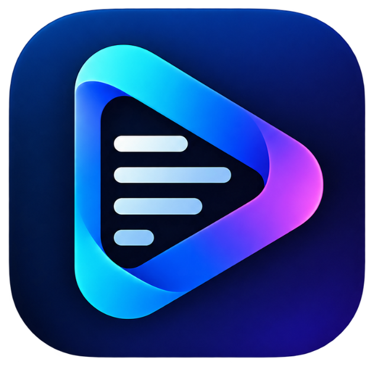

# CueFlow — Professional Teleprompter (Windows & Android)

<p align="center">
  
</p>

<p align="center">
  <strong>An offline-first, professional teleprompter designed for flawless speeches, presentations, online meetings, streaming, and video creation on Windows & Android.</strong>
</p>

<p align="center">
  <a href="https://github.com/shaniraj4587/CueFlow/releases/latest/download/CueFlow.Setup.1.0.0.exe">
    
  </a>
  <a href="https://github.com/shaniraj4587/CueFlow/releases/latest/download/CueFlow.1.0.0.exe">
    
  </a>
  <a href="https://github.com/shaniraj4587/CueFlow/releases/latest/download/CueFlow.apk">
    
  </a>
  <a href="https://github.com/shaniraj4587/CueFlow/releases/latest">
    
  </a>
  
</p>

---

## 📥 Download and Install

### 🪟 Windows (10 / 11, 64-bit)

Choose the edition that best suits your workflow:

| Edition | Direct Download | Description |
|---|---|---|
| **Windows Installer** | 👉 **[Download CueFlow Setup 1.0.0.exe](https://github.com/shaniraj4587/CueFlow/releases/latest/download/CueFlow.Setup.1.0.0.exe)** | Standard NSIS installer with Start Menu and Desktop shortcuts. |
| **Standalone Portable** | 👉 **[Download CueFlow 1.0.0.exe](https://github.com/shaniraj4587/CueFlow/releases/latest/download/CueFlow.1.0.0.exe)** | Single-file portable `.exe`. No installation required, runs directly from anywhere (USB drive, Desktop). |
| **Portable ZIP** | 👉 **[Download CueFlow-1.0.0-win.zip](https://github.com/shaniraj4587/CueFlow/releases/latest/download/CueFlow-1.0.0-win.zip)** | Unpack-and-run standalone archive with all binaries included. |

#### Windows Installation & Running Guide:
1. **Windows Installer**: Download `CueFlow Setup 1.0.0.exe`, double-click to install, and launch from your Desktop or Start Menu.
2. **Portable Executable**: Download `CueFlow 1.0.0.exe`, double-click to run immediately without any installation or administrator rights required.
3. *Note for Windows Defender / SmartScreen*: Because the binary is freshly built, click **"More info" → "Run anyway"** if SmartScreen appears.

---

### 📱 Android (Phones & Tablets)

👉 **[Download CueFlow.apk (Android 7.0+)](https://github.com/shaniraj4587/CueFlow/releases/latest/download/CueFlow.apk)** (51.0 MB)

#### Android Installation Steps:
1. Tap the **Download CueFlow.apk** link above on your Android phone or tablet.
2. Open your **Downloads** folder and tap **`CueFlow.apk`**.
3. If prompted with *"For your security, your phone is not allowed to install unknown apps from this source"*, tap **Settings** and enable **Allow from this source**.
4. Tap **Install** and open CueFlow.

---

## ✨ Key Features

### 🪟 Windows Floating Teleprompter Overlay
* **Always-on-Top Floating Window**: Floats above PowerPoint, OBS Studio, Zoom, Google Meet, Microsoft Teams, Discord, and webcam software.
* **Invisible Overlay Mode (`I` Key)**: Strips all headers, buttons, and borders leaving only semi-transparent text gliding across your screen. Hover mouse over the window at any time to reveal controls.
* **Calibrated Speeds (1X to 5X+)**:
  * `1X` = 24 px/s (steady, calm presentation pace)
  * `2X` = 44 px/s (natural conversational speech pace)
  * `3X` = 66 px/s (brisk speaker pace)
  * `4X` = 90 px/s (fast reading pace)
  * `5X` = 120 px/s (rapid scan & review)
  * Quick 1-click speed pills `[1X]` `[2X]` `[3X]` `[4X]` `[5X]` and fine-tuning `−` / `+` by 0.5x.
* **Comprehensive Keyboard Shortcuts**:
  * `Space`: Play / Pause scrolling
  * `1` - `5`: Direct jump to speed 1X–5X
  * `Arrow Up` / `Arrow Down`: Increase / decrease speed by 0.5x
  * `I`: Toggle Invisible floating mode
  * `F`: Toggle Mirror flip (for physical beam-splitter teleprompter glass rigs)
  * `R`: Rewind to beginning of script
  * `O`: Cycle Overlay Opacity (30% ➔ 50% ➔ 80% ➔ 100%)
  * `Esc`: Close floating overlay

### 🎙️ Real-Time Voice Follow (Speech Recognition)
* Automatically tracks spoken delivery and scrolls the script at your exact natural speaking speed.
* Continuous 60fps velocity engine with sliding-window Words-Per-Minute (WPM) calculation.
* Pauses smoothly when you take a pause, and glides forward as you speak.
* Supports **English** and **Hindi (`hi-IN`)** speech recognition models.
* Audio is processed strictly in real-time on-device; no recordings are ever saved or transmitted.

### 📐 Interactive Resizable Floating Teleprompter (Android & Windows)
* **Continuous Drag Resize Handle (`↘`)**: Grab and drag the bottom-right corner to freely resize width and height to any custom dimensions.
* **Instant Size Presets (`⤢`)**: 1-tap cycler between **Compact** (280×220), **Standard** (360×320), **Large** (460×420), and **Full Width**.
* **Remembers Your Size**: Custom dimensions are automatically saved to storage and preserved across sessions.
* **Transparent Background**: Adjustable overlay opacity (20% to 100%) so you can see your subject or meeting attendees underneath.

### 🇮🇳 Full Bilingual Interface (English & हिंदी)
* Complete 1-tap language switching across the entire app.
* Every button, slider, dialog, menu, and status bar updates instantly in real time.
* Devanagari Unicode tokenization preserving all Indic vowel marks (matras, halants, anusvaras).
* Bundled sample scripts in both English and Hindi.

### 📱 Samsung Galaxy Tab S9 FE & Tablet Optimization
* **Responsive Layouts**: Dynamic multi-column responsive grid on tablet screens.
* **Proportional Scroll Anchoring**: Rotating between portrait and landscape preserves exact percentage reading position with zero jumps.
* **Reading Margins**: Constrained reading column (`maxWidth: 860`) prevents wide lines from stretching awkwardly across large 11"–14" tablet screens.

### 👓 Professional Reading & Mirror Modes
* **Mirror Mode (Horizontal Flip)**: Flip text horizontally for beam-splitter prompter glass rigs.
* **Pacing Controls**: Adjustable scrolling speed, countdown before playback (0–10s), and deliberate blank-line pause durations.
* **Custom Typography**: Dynamic text size (18–72pt), line height, letter spacing, font style (Modern, Mono, Serif), and text alignment.
* **Reading Guides**: Highlight window, focal guide line, or subtle reading band.

### 🔒 100% Privacy & Zero Ads
* **No Advertisements**: Completely free with zero ads or tracking SDKs.
* **100% Offline Local Storage**: All scripts are saved directly on your device storage. No account required, no cloud sync, no tracking.
* **Zero Camera Permissions**: The app does not access your camera — it is built to run alongside your favorite recording device or camera app.

---

## 🛠️ Tech Stack & Architecture

* **Frontend**: React Native 0.76+ & React Native for Web (TypeScript)
* **Desktop Platform (Windows)**:
  * Electron 44+ with Chromium multi-window architecture.
  * Standalone transparent, frameless, always-on-top overlay window with sub-pixel float accumulation rendering.
  * Electron Builder packaging for NSIS Installer, Standalone Portable, and ZIP targets.
* **Mobile Platform (Android)**:
  * React Native Hermes Bytecode Engine.
  * Kotlin Native Modules: `FloatingTeleprompterService.kt` (WindowManager overlay), `VoiceFollowModule.kt` (Android SpeechRecognizer), `FileAccessModule.kt` (SAF file picker), `KeepAwakeModule.kt`.
* **State Management**: Reactive global publish/subscribe architecture for synchronous multi-screen updates.
* **Testing**: Comprehensive Jest test suite.

---

## 💻 Local Development Setup

To build and run CueFlow locally:

### Prerequisites:
* Node.js 18+ and npm
* Windows 10/11 (for Windows desktop builds)
* Android Studio with Android SDK API 34 (for Android builds)

### Steps:
```bash
# Clone the repository
git clone https://github.com/shaniraj4587/CueFlow.git
cd CueFlow

# Install dependencies
npm install

# Run unit tests
npm test
```

### Windows Desktop:
```bash
# Start desktop app in development mode
npm run start:desktop

# Build Windows production packages (Installer + Portable + Zip)
npm run dist:windows
# Output: dist/windows/
```

### Android:
```bash
# Run on connected Android device or emulator
npm run android

# Build Production Release APK
cd android
./gradlew assembleRelease
# Output: android/app/build/outputs/apk/release/app-release.apk
```

---

## 📄 Privacy Policy

CueFlow values user privacy above all else. Review our complete [PRIVACY_POLICY.md](PRIVACY_POLICY.md) for full details:
* Scripts remain strictly on your physical device.
* Audio data from Voice Follow is processed in real time and never stored, saved, or uploaded.
* No cameras, analytics, or external trackers are utilized.

---

## 📜 License

This project is licensed under the MIT License - see the LICENSE file for details.
